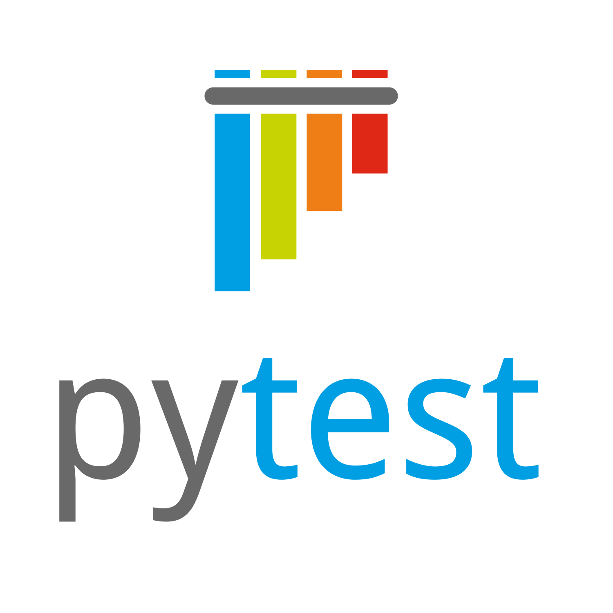

# Testing with pytest

## What is pytest?

:::{.columns}
::::{.column width=50%}
- A testing *framework* for python
- Makes it a lot easier to write tests
- Is used extensively by python packages
- Automatically discovers and runs tests
::::
::::{.column width=50%}
{style="width:50%;"}
::::
:::

## pytest basics

\

- Tests are .py files and live in a `tests/` directory
- Each test group is a function with prefix `test_`
- Use the `assert` keyword to validate an expression is true

\

:::{.columns}
::::{.column width=30%}
```{.python filename="src/add.py"}
def add(a, b):
  return a+b
```
```{.python filename="tests/test.py"}
def test_add():
  assert add(0, 0) == 0
  assert add(1, 0) == 1
  assert add(0, 1) == 1
  assert add(1, 1) == 2
  ...
```
::::
::::{.column width=70%}

```{=html}
<div class="code-with-filename-file"><pre><strong>terminal</strong></pre></div>
<div class="term-container">
<span class="term-fg1">===================================== test session starts =====================================</span>
platform linux -- Python 3.14.7, pytest-9.1.1, pluggy-1.6.0
rootdir: &#47;tmp&#47;example
<span class="term-fg1">collected 1 item                                                                              </span>
&nbsp;
tests&#47;test.py <span class="term-fg32">.                                                                         [100%]</span>
&nbsp;
<span class="term-fg32">====================================== </span><span class="term-fg32 term-fg1">1 passed</span><span class="term-fg32"> in 0.00s ======================================</span>
</div>
```
::::
:::

## pytest basics

What if we implemented `add` wrong?
  
```{.python filename="src/add,py"}
def add(a, b):
  return a-b # Incorrect
```

\

```{=html}
<div class="term-container">
<span class="term-fg32 term-fg1">[jack@nixos:~]$</span> pytest tests&#47;test.py
platform linux -- Python 3.14.7, pytest-9.1.1, pluggy-1.6.0
rootdir: &#47;tmp&#47;example
<span class="term-fg1">collected 1 item                                                                              </span>
&nbsp;
tests&#47;test.py <span class="term-fg31">F                                                                         [100%]</span>
&nbsp;
========================================== FAILURES ===========================================
<span class="term-fg31 term-fg1">__________________________________________ test_add ___________________________________________</span>
&nbsp;
    <span class="term-fgi94">def</span><span class="term-fgi90"> </span><span class="term-fgi92">test_add</span>():
      <span class="term-fgi94">assert</span> add(<span class="term-fgi94">0</span>, <span class="term-fgi94">0</span>) == <span class="term-fgi94">0</span>
      <span class="term-fgi94">assert</span> add(<span class="term-fgi94">1</span>, <span class="term-fgi94">0</span>) == <span class="term-fgi94">1</span>
&gt;     <span class="term-fgi94">assert</span> add(<span class="term-fgi94">0</span>, <span class="term-fgi94">1</span>) == <span class="term-fgi94">1</span>
<span class="term-fg31 term-fg1">E     assert -1 == 1</span>
<span class="term-fg31 term-fg1">E      +  where -1 = add(0, 1)</span>
&nbsp;
<span class="term-fg31 term-fg1">tests&#47;test.py</span>:7: AssertionError
<span class="term-fg36 term-fg1">=================================== short test summary info ===================================</span>
<span class="term-fg31">FAILED</span> tests&#47;test.py::<span class="term-fg1">test_add</span> - assert -1 == 1
<span class="term-fg31">====================================== </span><span class="term-fg31 term-fg1">1 failed</span><span class="term-fg31"> in 0.02s ======================================</span>
</div>
```

## Parametrized tests

- pytest implements a lot of useful tools to make writing tests easier
- One of these is test parametrization, which allows us to reuse tests for different
  inputs
- We only need to give the `pytest.mark.parametrize` decorator:
  - The names of the input variables
  - A list of tuples of inputs

```{.python filename="tests/test.py"}
@pytest.mark.parametrize("x,y,expected", [(0, 0, 0), (1, 0, 1), (0, 1, 1), (1, 1, 2)])
def test_add(x, y, expected):
  assert add(x, y) == expected
```

## What to test

- Beyond using fixed points, we can think about how a function should behave
- For example, our add function should have the following *properties*
  - `add(x,0) == x`
  - `add(x, y) == add(y, x)`
  - `add(x, add(y, z)) == add(add(x, y), z)`

## Writing code for unit testing

:::{.columns}
::::{.column width=50%}

- Unit testing forces us to write code that is minimal
- Decompose functions into their smallest logical unit
- Smaller functions are easier to test (and review!)
  - Fewer/simpler inputs
  - Can help to think of edge cases
::::
::::{.column width=50%}

Easier to test this:
```{.python}
def complicated_computation(data):
  z = computation_1(data.x, data.y)
  return computation_2(data.t, data.w, z)

def computation_1(x, y):
  result = atan2(x, y)
  # Maybe do something else here
  return result

def computation_2(t, w, z):
  result = exp((w+z)/t)
  # Maybe do something else here
  return result
```
Than this:
```{.python}
def complicated_computation(data):
  z = atan2(data.x, data.y)
  z = ...
  result = exp((data.w+z)/data.t)
  result = ...
  return result
```
::::
:::
