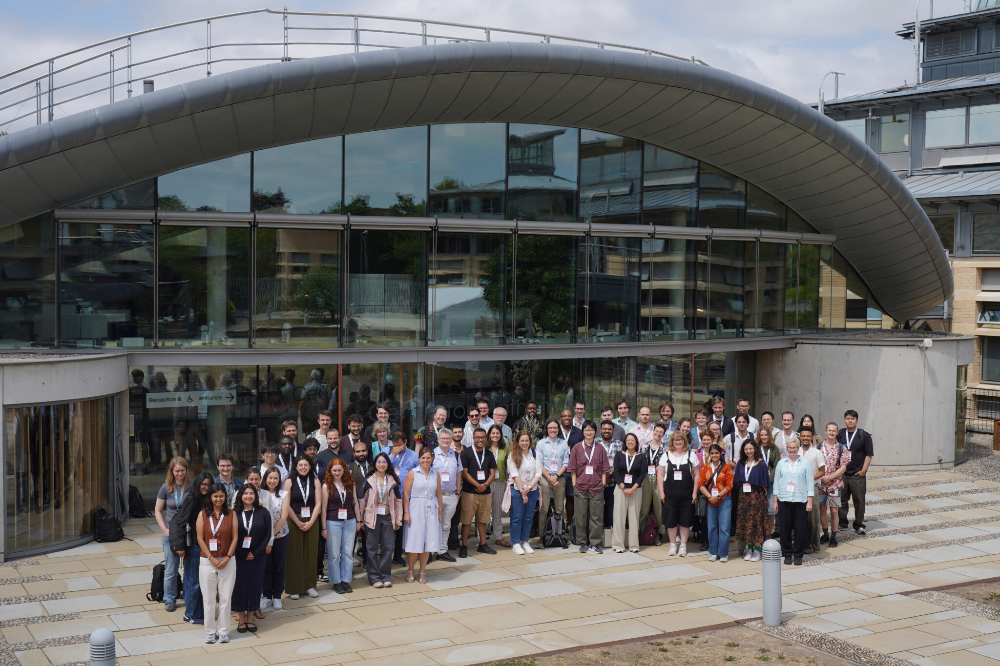























# Conclusion/Outlook

## Reproducibility is important

Primary benefits:

- Confidence in scientific results
- Peer review/cross analysis

Additional benefits:

- Allows for code reuse
- Better collaboration

## Ingredients for reproducibility:

&nbsp;

- Version Control
- Dependency Metadata
- Public Accessibility
  - Licence
- Documentation

## Even better if

&nbsp;

- Testing for:
  - Verification
  - Regression checks

## Make it easy!

- When starting from scratch, much easier to implement these as you go
- For a large project:
  - Add to VC
  - Document dependencies
  - Follow best practice for new code
  - Implement small improvements whenever modifying

## ICCS Summer School 2027

### Confirmed for 28/06 - 02/07!

:::{.columns}
::::{.column width=30%}
Register your interest here:

::::
::::{.column width=70%}

::::
:::
